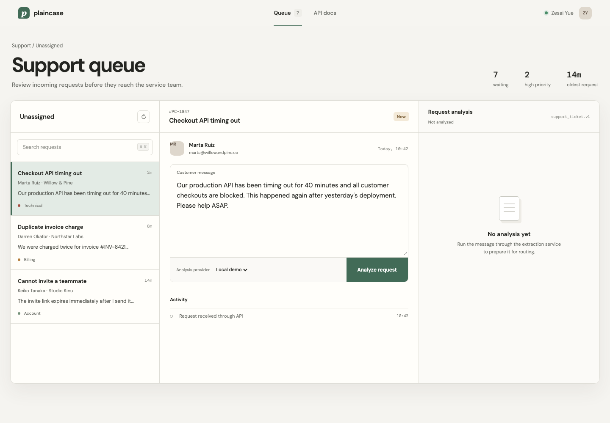

# Plaincase — Structured Support Request Service

A production-minded FastAPI service that turns unstructured customer messages into validated support-ticket data. It demonstrates the integration work behind reliable AI features: provider abstraction, strict schemas, bounded retries, timeouts, idempotency, audit history, and operational telemetry.

The included deterministic Mock Provider means the entire application and UI work without a paid API key. Add an OpenAI key to exercise the real structured-output path.



## What this project demonstrates

- **Reliable LLM integration** — OpenAI Responses API with Pydantic structured output
- **Provider abstraction** — switch between `mock` and `openai` without changing business logic
- **Production safeguards** — timeouts, exponential backoff, normalized errors, and idempotency
- **Observable operations** — request IDs, structured JSON logs, latency, attempts, and audit records
- **Delivery readiness** — Docker, health check, tests, CI, interactive API docs, and responsive demo UI

## Architecture

```text
Browser / API client
        │
        ▼
 FastAPI route ── input validation
        │
        ▼
 Extraction service ── idempotency lookup ── SQLite audit store
        │
        ├── Mock provider (zero-config demo)
        └── OpenAI provider (Responses API + structured output)
        │
        ▼
 Pydantic validation ── telemetry ── persisted result
```

## Quick start

Requires Python 3.12+ and [uv](https://docs.astral.sh/uv/).

```bash
cp .env.example .env
uv sync --all-extras
uv run uvicorn app.main:app --reload
```

Open:

- Demo UI: `http://localhost:8000`
- Swagger docs: `http://localhost:8000/docs`
- Health: `http://localhost:8000/api/v1/health`

The default provider is `mock`; no credentials or external services are needed.

## OpenAI mode

Set these values in `.env`:

```dotenv
DEFAULT_PROVIDER=openai
OPENAI_API_KEY=your_key_here
OPENAI_MODEL=gpt-4o-mini
```

Keys remain server-side and `.env` is ignored by Git. The adapter uses the official Python SDK and `responses.parse(..., text_format=SupportTicket)` so the output is checked against the application schema.

## API example

```bash
curl -X POST http://localhost:8000/api/v1/extract/support-ticket \
  -H 'Content-Type: application/json' \
  -H 'Idempotency-Key: checkout-outage-001' \
  -d '{
    "provider": "mock",
    "text": "Our production API is down and checkout is blocked. Please help ASAP."
  }'
```

Response:

```json
{
  "data": {
    "category": "technical",
    "priority": "urgent",
    "summary": "Our production API is down and checkout is blocked. Please help ASAP.",
    "next_action": "Reproduce the issue and inspect service logs using the supplied context.",
    "sentiment": "neutral",
    "requires_human": true,
    "tags": ["api", "production"]
  },
  "meta": {
    "request_id": "req_...",
    "provider": "mock",
    "model": "deterministic-rules-v1",
    "attempts": 1,
    "latency_ms": 181,
    "cached": false,
    "validated": true,
    "created_at": "2026-09-29T00:00:00Z"
  }
}
```

Resend the same request with the same `Idempotency-Key` to receive the stored result without another provider call.

## Test and quality checks

```bash
uv run ruff check .
uv run pytest -q
```

The tests cover health, validation, structured extraction, audit persistence, and duplicate-safe execution.

## Docker

```bash
docker compose up --build
```

The container runs as a non-root user, includes a health check, and stores the audit database in a named volume.

## Design decisions

- SQLite keeps the demo self-contained while the `AuditStore` boundary can be replaced with PostgreSQL.
- Provider retries are intentionally bounded; permanent errors fail immediately.
- The OpenAI SDK's internal retries are disabled so retry policy stays visible and testable in the service layer.
- The API key never reaches the browser.
- The mock path is deterministic, which makes local demos and CI repeatable.

## Production extensions

For a client deployment, the next steps would typically include PostgreSQL, Redis-backed distributed idempotency, authentication, rate limiting, OpenTelemetry traces, and deployment to the client's cloud environment.

## Author

Built by **Zesai Yue**, Python & FastAPI backend developer focused on API and AI integrations.
